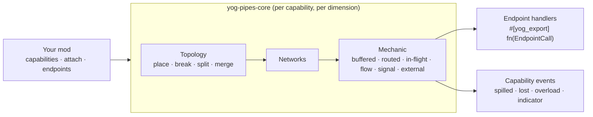

<div align="center">

<a id="top"></a>

# 🔌 Yog Pipes

### A transport framework for Yog mods: pipes, networks, routing and delivery

[](LICENSE)
[](yog.toml)
[](https://crates.io/crates/yog_pipes_exports)
[](#-license)
[](https://github.com/F000NKKK/Yog-Mod-Loader)

🇺🇸 **English** | 🇷🇺 [Русский](README.ru.md)

[Overview](#-overview) • [Quick Start](#-quick-start) • [How It Works](#-how-it-works) • [API](#-api) • [Limitations](#-known-limitations) • [Building](#-building) • [License](#-license)

</div>

---

## 📖 Overview

**Yog Pipes** is not a set of ready-made pipes. It is one abstract pipe that
other [Yog](https://github.com/F000NKKK/Yog-Mod-Loader) mods build theirs on,
whatever they carry: items, fluid, energy, signals or messages. It adds no
blocks, items or recipes of its own and gives mods the hard parts:

- 🧱 **Pipe blocks**: your own blocks from `.yblock` content, made pipes of a
  capability with `attach`. One block may carry several capabilities, each
  with its own networks
- 🧩 **Capabilities**: what pipes carry (`register_capability`), named by
  your mod, with its resource kinds and a *mechanic*: buffered (shared
  buffer), routed (instant, with loss and packet limits), in-flight (units
  travelling block by block), flow (levels with pressure), signal (channels
  with attenuation), or an external mechanic another mod implements
- 🔌 **Endpoints**: the blocks pipes exchange with (`register_endpoint`); your
  `#[yog_export]` handler gets every insert, extract, signal and message
- ⚖️ **Conservation**: units move only between a network and an endpoint
  that accepted them; what has to leave otherwise (a broken pipe, an
  overflow) is reported to the capability's owner as an event
- 🎛️ **Sides and indicators**: per-face modes, filters, priorities and
  colors; block-state indicators of fill, flow, units or power
- 📬 **Messaging**: `post`, `broadcast`, `receive`, `latest` over a network
- 💾 **Persistence**: everything the networks hold is saved with the world;
  the topology is rediscovered from it

The engine is the game-independent `yog-pipes-core` crate (`core/`); this mod
is its host.

## 🚀 Quick Start

Add Yog Pipes as a mod dependency:

```bash
yog add --mod yog-pipes
```

This writes it into your `yog.toml`:

```toml
[dependencies.exports]
yog-pipes = "0.13"
```

A pipe is ordinary content: declare the block in a `.yblock` (model,
connection arm, `connect_groups`, name and tooltip from your `.yres`):

```jsonc
// content/blocks/copper_pipe.yblock
{
  "name": "@Strings.copper_pipe",
  "tooltip": "@Strings.copper_pipe.desc",
  "block": { "hardness": 1.5, "sound": "metal", "connect_groups": ["pipe_item"] },
  "model": { "textures": { "pipe": "minecraft:block/copper_block" }, "elements": [ /* the core */ ] },
  "states": { "connect": { "arm": { /* the arm towards north */ } } }
}
```

then mark it as a pipe. `yog build` maps the dependency to the
`yog_pipes_exports` crate, so you call the functions like a normal Rust
library while the code itself runs inside the Yog Pipes mod at runtime:

```rust
use crate::content::Blocks;
use yog_pipes::{attach, register_capability, AttachDef, CapabilityDef, Distribution, Mechanic};

// What the pipe carries: items travelling block by block.
register_capability(CapabilityDef {
    name: "mymod:items".into(),
    kinds: Vec::new(),
    exclusive: true,
    state_prefix: "items".into(),
    indicators: Vec::new(),
    distribution: Distribution::RoundRobin,
    events: None,
    mechanic: Mechanic::InFlight,
}).expect("Yog Pipes is loaded").unwrap();
let pipe = Blocks::copper_pipe();
attach(AttachDef {
    block: pipe.id,
    capability: "mymod:items".into(),
    groups: pipe.connect_groups, // the same groups the arms connect by
    params: [("speed".into(), 0.5)].into(),
}).expect("Yog Pipes is loaded").unwrap();
```

Recipes are your mod's own content (`content/recipes/*.yrecipe`). Players need
both `.yog` files in `yog-mods/`: yours and Yog Pipes.
[`examples/copper-pipes/`](examples/copper-pipes) is a complete mod with one
pipe.

### Endpoints and messages

```rust
use yog_pipes::{EndpointDef, EndpointTarget, Handler, PipePayload, PipePos, broadcast, post, register_endpoint};

// Every `mymod:crate` block takes and gives items through the pipes;
// `#[yog_export] fn on_crate(call: EndpointCall) -> EndpointReply` does it.
register_endpoint(EndpointDef {
    capability: "mymod:items".into(),
    target: EndpointTarget::Block("mymod:crate".into()),
    kinds: Vec::new(),
    can_insert: true,
    can_extract: true,
    listens_signals: false,
    listens_messages: false,
    groups: Vec::new(),
    priority: 0,
    max_packet: 0,
    pressure: 0,
    handler: Some(Handler { mod_id: "mymod".into(), symbol: "on_crate".into() }),
}).expect("Yog Pipes is loaded").unwrap();

let pos = |x, y, z| PipePos { dim: "minecraft:overworld".into(), x, y, z };
let msg = PipePayload { data: vec![15], metadata: vec![] };
// To one endpoint on the same network: false if not connected or its inbox is full.
let delivered = post("mymod:bus".into(), pos(0, 64, 0), pos(4, 64, 0), msg.clone()).expect("Yog Pipes is loaded").unwrap();
// To every endpoint that listens to messages; kept as the network's latest value.
let reached = broadcast("mymod:bus".into(), pos(0, 64, 0), msg).expect("Yog Pipes is loaded").unwrap();
```

## ⚙️ How It Works



1. **Topology.** Kept per capability and dimension, incrementally: placing a
   pipe joins or merges networks, breaking one splits them. Adjacent pipes
   link when their groups meet (and their colors, if colored). Players'
   placing and breaking and explosions are tracked; after other changes
   (`set_block`, structures, `/setblock`) call `refresh(pos)`.
2. **Scheduling.** A network ticks only while active: after a topology
   change, an endpoint attached, `wake(pos)`, a signal emitted, or while its
   mechanic asks to. Idle networks cost nothing per tick.
3. **Mechanics** move resources between endpoints by their rules and the
   capability's distribution (round robin, priority, nearest, even split,
   random); attach parameters (`speed`, `capacity`, `throughput`, …) tune
   them per pipe block.
4. **Endpoints** answer through their handlers, found by `(mod_id, symbol)`
   through the interop every Yog export uses, so they survive reloads.

## 📚 API

| Function | What it does |
|---|---|
| `register_kind(KindDef)` | A resource kind: discrete or continuous, how portions merge, its unit, conversions |
| `register_capability(CapabilityDef)` | A capability: kinds, mechanic, distribution, indicators, an events handler |
| `attach(AttachDef)` | Make a block a pipe of a capability, with its link groups and mechanic params |
| `register_endpoint(EndpointDef)` / `unregister_endpoint` | A block type or one position pipes exchange with |
| `set_side`, `set_color` | One face's mode, filter, priority and color; a pipe's color |
| `refresh(pos)`, `wake(pos)` | Re-read a block after unseen changes; tick its networks now |
| `emit`, `level` | Drive / read a signal level on a channel |
| `post`, `broadcast`, `receive`, `latest` | Messages over a network |
| `network_info`, `pipe_info`, `indication` | What a network holds, a pipe's capabilities and faces, its indicator values |

Every function answers `Option<Result<_, String>>`: `None` when Yog Pipes isn't loaded (or failed). The types (`PipePos`,
`PipePayload`, `Stack`, `EndpointCall`, `EndpointReply`, `PipeEvent`, …) are
in the `yog_pipes_exports` crate. The design in full:
[`docs/design/transport.md`](docs/design/transport.md).

## ⚠️ Known Limitations

- **Unseen changes.** Pistons, `/setblock`, structures and other mods'
  `set_block` aren't observed: call `refresh(pos)`.
- **Endpoints are explicit.** A block takes part only once registered as an
  endpoint of the capability (by type, or by position for other mods' and
  vanilla blocks).

## 🔨 Building

```bash
yog build                  # -> bin/yog-pipes.yog
yog run fabric 1.21.1      # dev game from the loader SDK (Yog Installer, or ~/.yog/local.toml)
yog publish exports        # publish yog_pipes_exports to crates.io
```

## 📄 License

The mod is **AGPL-3.0-only** ([LICENSE](LICENSE)). The generated
`yog_pipes_exports` crate is **MIT OR Apache-2.0**, so depending on Yog Pipes
never puts your own mod under the AGPL.

---

<div align="center">

**[⬆ Back to Top](#top)**

Part of the [Yog](https://github.com/F000NKKK/Yog-Mod-Loader) project

</div>
