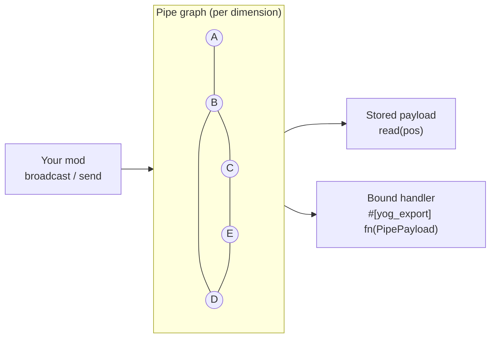

<div align="center">

<a id="top"></a>

# 🔌 Yog Pipes

### A transport framework for Yog mods: pipes, networks, routing and delivery

[](LICENSE)
[](yog.toml)
[](https://crates.io/crates/yog_pipes_exports)
[](#-license)
[](https://github.com/F000NKKK/Yog-Mod-Loader)

🇺🇸 **English** | 🇷🇺 [Русский](README.ru.md)

[Overview](#-overview) • [Quick Start](#-quick-start) • [How It Works](#-how-it-works) • [API](#-api) • [Limitations](#-known-limitations) • [Building](#-building) • [License](#-license)

</div>

---

## 📖 Overview

**Yog Pipes** is not a set of ready-made pipes, and it doesn't care what a
pipe carries: items, fluid, a redstone-like signal or something your mod
invents. It gives other [Yog](https://github.com/F000NKKK/Yog-Mod-Loader)
mods the hard parts:

- 🧱 **Pipe blocks**: your own blocks from `.yblock` content files, marked as pipes with `register_pipe`
- 🕸️ **Connectivity**: pipes link to neighbours that share a link group, in a
  graph checked against the real world. Branching is the normal case: a node
  can have 0 to 6 neighbours, loops included
- 📡 **Routing**: broadcast a payload to the whole network, or send it point
  to point along the shortest path
- 📬 **Delivery**: bind a function from your mod to a position, and Yog Pipes
  calls it when a payload arrives there
- 💾 **Persistence**: delivered payloads and handler bindings are saved with the world

What a payload *means* (an item stack, a fluid amount, a signal level)
is up to the mods that send and receive it.

## 🚀 Quick Start

Add Yog Pipes as a mod dependency:

```bash
yog add --mod yog-pipes
```

This writes it into your `yog.toml`:

```toml
[dependencies.exports]
yog-pipes = "0.8"
```

A pipe is ordinary content: declare the block in a `.yblock` (model,
connection arm, `connect_groups`, name and tooltip from your `.yres`):

```jsonc
// content/blocks/copper_pipe.yblock
{
  "name": "@Strings.copper_pipe",
  "tooltip": "@Strings.copper_pipe.desc",
  "block": { "hardness": 1.5, "sound": "metal", "connect_groups": ["pipe_item"] },
  "model": { "textures": { "pipe": "minecraft:block/copper_block" }, "elements": [ /* the core */ ] },
  "states": { "connect": { "arm": { /* the arm towards north */ } } }
}
```

then mark it as a pipe. `yog build` maps the dependency to the
`yog_pipes_exports` crate, so you call the functions like a normal Rust
library while the code itself runs inside the Yog Pipes mod at runtime:

```rust
use crate::content::Blocks;
use yog_pipes::{attach, register_capability, AttachDef, CapabilityDef, Distribution, Mechanic};

// What the pipe carries: items travelling block by block.
register_capability(CapabilityDef {
    name: "mymod:items".into(),
    kinds: Vec::new(),
    exclusive: true,
    state_prefix: "items".into(),
    indicators: Vec::new(),
    distribution: Distribution::RoundRobin,
    events: None,
    mechanic: Mechanic::InFlight,
}).unwrap();
let pipe = Blocks::copper_pipe();
attach(AttachDef {
    block: pipe.id,
    capability: "mymod:items".into(),
    groups: pipe.connect_groups, // the same groups the arms connect by
    params: [("speed".into(), 0.5)].into(),
}).unwrap();
```

Recipes are your mod's own content (`content/recipes/*.yrecipe`). Players need
both `.yog` files in `yog-mods/`: yours and Yog Pipes.
[`examples/copper-pipes/`](examples/copper-pipes) is a complete mod with one
pipe.

### Sending payloads

```rust
use yog_pipes::{PipePayload, PipePos, bind_handler, broadcast, read, send};

let pos = |x, y, z| PipePos { dim: "minecraft:overworld".into(), x, y, z };

// Every node connected to (0, 64, 0) gets this: redstone-style fan-out.
// Call it when the value changes, not every tick.
broadcast(pos(0, 64, 0), PipePayload { data: vec![15], metadata: vec![] }).unwrap();

// One specific destination along the shortest path; false if not connected.
let delivered = send(pos(0, 64, 0), pos(4, 64, 0), PipePayload {
    data: item_bytes,
    metadata: vec![("kind".into(), "item".into())],
}).unwrap();

// Poll the last payload at a position...
let last = read(pos(4, 64, 0)).unwrap();

// ...or have `#[yog_export] fn on_pipe_payload(p: PipePayload)` from your
// mod called on every delivery.
bind_handler(pos(4, 64, 0), "my-mod".into(), "on_pipe_payload".into()).unwrap();
```

## ⚙️ How It Works



1. **Graph.** Kept up to date incrementally, per dimension, by checking the
   real world. A neighbour becomes an edge only if it was marked with
   `register_pipe` **and** shares at least one `link_groups` tag; the same
   rule draws the blocks' connection arms. Placing a pipe explores only
   unknown positions, breaking one removes just that node, and an explosion
   re-checks the nodes in its reach. Networks built before a restart, or by
   `/setblock`, are discovered the first time `broadcast`/`send` touches
   them; `refresh(pos)` re-reads one explicitly.
2. **Broadcast** reaches every node connected to the source, stores the
   payload there and calls any bound handler. Good for signals.
3. **Send** finds the shortest path and delivers only to the destination.
   Good for moving items or fluid between two endpoints.
4. **Handlers** are ordinary `#[yog_export]` functions in any mod, found by
   `(mod_id, symbol)` through the same interop every Yog export uses. No
   extra callback ABI.

Yog Pipes runs no tick loop of its own: payloads move when you call
`broadcast`/`send`, event-driven like vanilla redstone.

## 📚 API

| Item | What it is |
|---|---|
| `PipeDef { block_id, kind, link_groups, properties }` | Marks one of your blocks as a pipe. `link_groups`: normally the block's `connect_groups`. `properties` is an open `HashMap<String, f64>`: speed, capacity, anything; Yog Pipes never reads it |
| `PipeKind` | `Item`, `Fluid`, `Signal`, `Energy`, `Custom(String)`. Descriptive only, never used for routing |
| `register_pipe(def)` | Marks `def.block_id` as a pipe (the block itself is yours, registered from `.yblock`) |
| `pipe_def(block_id) -> Option<PipeDef>` | What a block was registered with, for mods that read other mods' pipes |
| `PipePos { dim, x, y, z }` | A world position; `dim` like `"minecraft:overworld"` (a bare `"overworld"` gets the namespace) |
| `PipePayload { data: Vec<u8>, metadata: Vec<(String, String)> }` | Opaque bytes plus tags; Yog Pipes never reads them |
| `broadcast(pos, payload)` | Deliver to every connected node |
| `send(from, to, payload) -> bool` | Deliver along the shortest path |
| `read(pos) -> Option<PipePayload>` | The last payload delivered to `pos` |
| `bind_handler(pos, mod_id, symbol)` / `unbind_handler(pos)` | Attach or remove a handler |
| `refresh(pos)` | Re-read the network around `pos` after changes the graph can't see |

All functions return `Result<_, String>`. Inside Yog Pipes `broadcast` and
`send` take a leading `&mut Registry` (to dispatch handlers); the exports
crate hides it, so callers don't pass it.

Source layout: `src/pipe.rs` (which blocks are pipes), `graph.rs` (the
network), `transport.rs` (broadcast/send/read/bindings), `handler.rs`
(dispatch through interop), `persist.rs` (saving), `payload.rs`, `kind.rs`;
the mod's name and description are in `resources/Strings*.yres`.

## ⚠️ Known Limitations

- **Endpoints are pipe positions.** Only blocks marked with
  `register_pipe` are nodes. A chest or machine next to a pipe is reached by
  binding a handler on the pipe beside it.
- **Changes made without a player** (pistons, `/setblock`, another mod's
  `set_block`) aren't observed: call `refresh(pos)`. A removed pipe stays in
  the graph until something re-checks it.
- **Persistence.** Stored payloads and bindings go to
  `<world>/yog-data/yog-pipes/global.ydata` on server stop and every 5 minutes;
  the graph itself is rediscovered. A crash loses changes since the last
  autosave. The world folder is found as the save with the newest
  `session.lock`, since yog-api has no world-path hook yet.

## 🔨 Building

```bash
yog build                  # -> artifacts/yog-pipes.yog
yog run fabric 1.21.1      # dev game from the loader SDK (Yog Installer, or ~/.yog/local.toml)
yog publish exports        # publish yog_pipes_exports to crates.io
```

## 📄 License

The mod is **AGPL-3.0-only** ([LICENSE](LICENSE)). The generated
`yog_pipes_exports` crate is **MIT OR Apache-2.0**, so depending on Yog Pipes
never puts your own mod under the AGPL.

---

<div align="center">

**[⬆ Back to Top](#top)**

Part of the [Yog](https://github.com/F000NKKK/Yog-Mod-Loader) project

</div>
