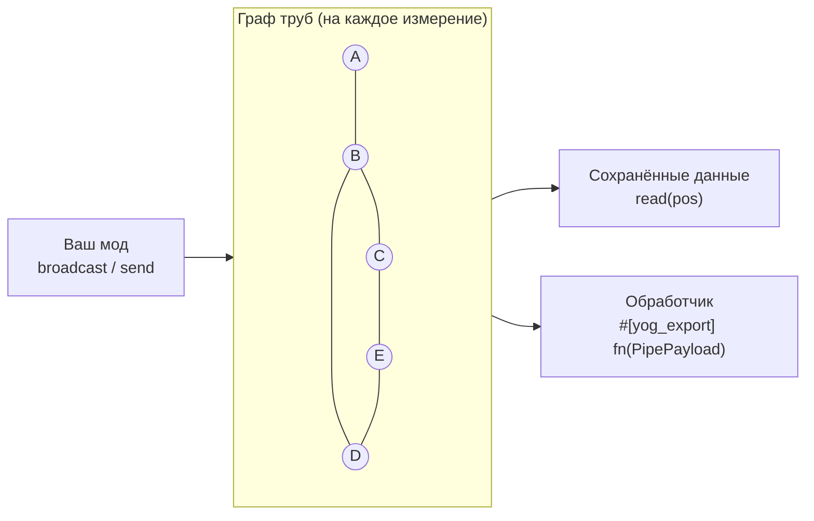

<div align="center">

<a id="top"></a>

# 🔌 Yog Pipes

### Транспортный фреймворк для модов Yog: трубы, сети, маршрутизация и доставка

[](LICENSE)
[](yog.toml)
[](https://crates.io/crates/yog_pipes_exports)
[](#-лицензия)
[](https://github.com/F000NKKK/Yog-Mod-Loader)

🇺🇸 [English](README.md) | 🇷🇺 **Русский**

[Обзор](#-обзор) • [Быстрый старт](#-быстрый-старт) • [Как это работает](#-как-это-работает) • [API](#-api) • [Ограничения](#-известные-ограничения) • [Сборка](#-сборка) • [Лицензия](#-лицензия)

</div>

---

## 📖 Обзор

**Yog Pipes** — это не набор готовых труб, и ему всё равно, что по трубе
идёт: предметы, жидкость, энергия, сигнал вроде редстоуна или что-то, что
придумал ваш мод. Он берёт на себя сложную часть работы для других модов на
[Yog](https://github.com/F000NKKK/Yog-Mod-Loader):

- 🧱 **Блоки труб**: регистрируйте свои через `PipeDef` (форма, рецепты, группы соединений)
- 🕸️ **Соединения**: трубы соединяются с соседями из той же группы, а граф
  сверяется с реальным миром. Ветвление — обычное дело: у узла от 0 до 6
  соседей, циклы тоже поддерживаются
- 📡 **Маршрутизация**: разослать данные по всей сети или отправить их в одну
  точку по кратчайшему пути
- 📬 **Доставка**: привяжите функцию своего мода к позиции, и Yog Pipes
  вызовет её, когда туда что-то придёт
- 💾 **Сохранение**: доставленные данные и привязки обработчиков сохраняются вместе с миром

Что именно *означают* данные (стак предметов, порция энергии, уровень
сигнала), решают моды, которые их отправляют и принимают.

## 🚀 Быстрый старт

Добавьте Yog Pipes как зависимость-мод:

```bash
yog add --mod yog-pipes
```

Команда запишет в ваш `yog.toml`:

```toml
[dependencies.exports]
yog-pipes = "0.3"
```

`yog build` подключит крейт `yog_pipes_exports`: функции вызываются как из
обычной Rust-библиотеки, а сам код во время игры выполняется внутри мода
Yog Pipes:

```rust
use yog_pipes::{PipeDef, PipeKind, RecipeDef, register_pipe};

register_pipe(PipeDef {
    block_id: "mymod:pipe_iron".into(),
    kind: PipeKind::Item,
    properties: [("speed".into(), 2.0), ("capacity".into(), 64.0)].into(),
    model: None,                       // стандартная труба 8x8x8
    link_groups: vec!["pipe_item".into(), "inventory".into()],
    recipe: vec![RecipeDef::Shaped {
        rows: vec!["III".into()],
        keys: vec![('I', "minecraft:iron_ingot".into())],
        result_count: 4,
    }],
}).unwrap();
```

Игрокам нужны оба файла `.yog` в `yog-mods/`: ваш и Yog Pipes.
В [`examples/standard_pipes.rs`](examples/standard_pipes.rs) регистрируется
полный набор труб: для предметов, жидкостей, сигналов, энергии и своего типа.

### Отправка данных

```rust
use yog_pipes::{PipePayload, PipePos, bind_handler, broadcast, read, send};

let pos = |x, y, z| PipePos { dim: "minecraft:overworld".into(), x, y, z };

// Получит каждый узел, связанный с (0, 64, 0): рассылка как у редстоуна.
// Вызывайте при изменении значения, а не каждый тик.
broadcast(pos(0, 64, 0), PipePayload { data: vec![15], metadata: vec![] }).unwrap();

// Одна конкретная точка по кратчайшему пути; false, если пути нет.
let delivered = send(pos(0, 64, 0), pos(4, 64, 0), PipePayload {
    data: item_bytes,
    metadata: vec![("kind".into(), "item".into())],
}).unwrap();

// Можно опрашивать последнее значение в точке...
let last = read(pos(4, 64, 0)).unwrap();

// ...или пусть при каждой доставке вызывается
// `#[yog_export] fn on_pipe_payload(p: PipePayload)` из вашего мода.
bind_handler(pos(4, 64, 0), "my-mod".into(), "on_pipe_payload".into()).unwrap();
```

## ⚙️ Как это работает



1. **Граф** обновляется постепенно, отдельно для каждого измерения, и
   сверяется с реальным миром. Сосед становится ребром, только если он
   зарегистрирован через `register_pipe` **и** у них есть общая метка из
   `link_groups`; по тому же правилу рисуются соединительные отводы блоков.
   Установка трубы исследует только неизвестные позиции, поломка убирает
   один узел, а взрыв перепроверяет узлы в радиусе. Сети, построенные до
   перезапуска или через `/setblock`, обнаруживаются при первом
   `broadcast`/`send`; `refresh(pos)` перечитывает участок явно.
2. **Broadcast** доходит до каждого связанного узла, сохраняет там данные и
   вызывает привязанный обработчик. Подходит для сигналов.
3. **Send** ищет кратчайший путь и доставляет только адресату. Подходит для
   перемещения предметов, жидкости или энергии между двумя точками.
4. **Обработчики** — обычные функции `#[yog_export]` в любом моде, которые
   находятся по `(mod_id, symbol)` через тот же interop, что и все экспорты
   Yog. Отдельного ABI для колбэков нет.

Своего тикового цикла у Yog Pipes нет: данные движутся, когда вы вызываете
`broadcast`/`send`, по событиям, как ванильный редстоун.

## 📚 API

| Элемент | Что это |
|---|---|
| `PipeDef { block_id, kind, properties, model, link_groups, recipe }` | Один блок трубы. `properties` — открытый `HashMap<String, f64>`: скорость, ёмкость, давление, что угодно |
| `PipeKind` | `Item`, `Fluid`, `Signal`, `Energy`, `Custom(String)`. Только описание, на маршрутизацию не влияет |
| `RecipeDef` | `Shaped { rows, keys, result_count }`, `Shapeless { ingredients, result_count }`, `Furnace { input, result_count, experience, cook_time }` |
| `ModelDef` / `ModelElement` / `FaceDef` / `ElementRotation` | Модель блока в виде данных (см. [ограничения](#-известные-ограничения)) |
| `register_pipe(def)` | Регистрирует блок, его предмет и рецепты |
| `PipePos { dim, x, y, z }` | Позиция в мире; `dim` вроде `"minecraft:overworld"` (к голому `"overworld"` пространство имён добавится само) |
| `PipePayload { data: Vec<u8>, metadata: Vec<(String, String)> }` | Непрозрачные байты и метки; Yog Pipes их не читает |
| `broadcast(pos, payload)` | Доставить во все связанные узлы |
| `send(from, to, payload) -> bool` | Доставить по кратчайшему пути |
| `read(pos) -> Option<PipePayload>` | Последние данные, доставленные в `pos` |
| `bind_handler(pos, mod_id, symbol)` / `unbind_handler(pos)` | Привязать или снять обработчик |
| `refresh(pos)` | Перечитать сеть вокруг `pos` после изменений, которых граф не видит |

Все функции возвращают `Result<_, String>`. Внутри Yog Pipes у них есть
первый параметр `&mut Registry`; крейт экспортов его скрывает, вызывающему
передавать его не нужно.

Исходники: `src/pipe.rs` (регистрация), `graph.rs` (сеть), `transport.rs`
(broadcast/send/read/привязки), `handler.rs` (вызов через interop),
`persist.rs` (сохранение), `model.rs`, `recipe.rs`, `payload.rs`, `kind.rs`.

## ⚠️ Известные ограничения

- **Модели.** Сейчас используется только габарит элементов (он становится
  формой коллизии). Текстуры, грани и поворот из `ModelDef` принимаются, но
  пока не отрисовываются.
- **Конечные точки — это трубы.** Узлами графа бывают только блоки,
  зарегистрированные через `register_pipe`. До сундука или машины рядом с
  трубой достучаться можно, привязав обработчик к соседней трубе.
- **Изменения не от игрока** (поршни, `/setblock`, `set_block` другого мода)
  граф не замечает: вызовите `refresh(pos)`. Убранная труба остаётся в
  графе, пока её кто-нибудь не перепроверит.
- **Сохранение.** Данные и привязки пишутся в
  `<мир>/yog-data/yog-pipes/global.kv` при остановке сервера и раз в 5
  минут; сам граф восстанавливается заново. При вылете теряется всё после
  последнего автосохранения. Папка мира определяется как сохранение с самым
  свежим `session.lock`, потому что у yog-api пока нет способа узнать путь
  к миру.

## 🔨 Сборка

```bash
yog build                  # -> artifacts/yog-pipes.yog
yog run fabric-1.21.1      # dev-игра; нужен Yog-Mod-Loader рядом с этим репозиторием
yog publish exports        # опубликовать yog_pipes_exports на crates.io
```

## 📄 Лицензия

Сам мод — **AGPL-3.0-only** ([LICENSE](LICENSE)). Сгенерированный крейт
`yog_pipes_exports` — **MIT OR Apache-2.0**, поэтому зависимость от Yog
Pipes не переводит ваш мод под AGPL.

---

<div align="center">

**[⬆ Наверх](#top)**

Часть проекта [Yog](https://github.com/F000NKKK/Yog-Mod-Loader)

</div>
