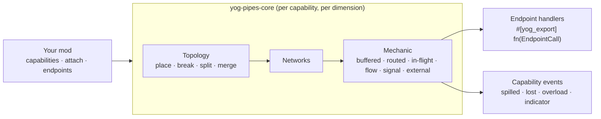

<div align="center">

<a id="top"></a>

# 🔌 Yog Pipes

### Транспортный фреймворк для модов Yog: трубы, сети, маршрутизация и доставка

[](LICENSE)
[](yog.toml)
[](https://crates.io/crates/yog_pipes_exports)
[](#-лицензия)
[](https://github.com/F000NKKK/Yog-Mod-Loader)

🇺🇸 [English](README.md) | 🇷🇺 **Русский**

[Обзор](#-обзор) • [Быстрый старт](#-быстрый-старт) • [Как это работает](#-как-это-работает) • [API](#-api) • [Ограничения](#-известные-ограничения) • [Сборка](#-сборка) • [Лицензия](#-лицензия)

</div>

---

## 📖 Обзор

**Yog Pipes** — не набор готовых труб. Это одна абстрактная труба, на
которой другие моды [Yog](https://github.com/F000NKKK/Yog-Mod-Loader) строят
свои, что бы они ни переносили: предметы, жидкость, энергию, сигналы или
сообщения. Своих блоков, предметов и рецептов он не добавляет, а берёт на
себя самое сложное:

- 🧱 **Блоки труб**: ваши собственные блоки из контента `.yblock`, которые
  `attach` делает трубами возможности. Один блок может нести несколько
  возможностей, у каждой свои сети
- 🧩 **Возможности**: что переносят трубы (`register_capability`) — с именем
  вашего мода, видами ресурсов и *механикой*: buffered (общий буфер), routed
  (мгновенно, с потерями и лимитом пакета), in-flight (единицы, едущие от
  блока к блоку), flow (уровни с давлением), signal (каналы с затуханием) или
  внешняя механика, которую реализует другой мод
- 🔌 **Конечные точки**: блоки, с которыми трубы обмениваются
  (`register_endpoint`); ваш обработчик `#[yog_export]` получает каждую
  вставку, извлечение, сигнал и сообщение
- ⚖️ **Сохранение количества**: единицы переходят только между сетью и
  конечной точкой, которая их приняла; то, что вынуждено уйти иначе (сломана
  труба, переполнение), сообщается владельцу возможности событием
- 🎛️ **Стороны и индикаторы**: режим, фильтр, приоритет и цвет каждой грани;
  индикаторы заполнения, потока, единиц или мощности в состоянии блока
- 📬 **Сообщения**: `post`, `broadcast`, `receive`, `latest` по сети
- 💾 **Сохранение**: всё, что держат сети, сохраняется вместе с миром;
  топология заново находится по миру

Движок — независимый от игры крейт `yog-pipes-core` (`core/`); этот мод — его
хост.

## 🚀 Быстрый старт

Добавьте Yog Pipes как зависимость-мод:

```bash
yog add --mod yog-pipes
```

Команда запишет в ваш `yog.toml`:

```toml
[dependencies.exports]
yog-pipes = "0.13"
```

Труба — обычный контент: объявите блок в `.yblock` (модель, отвод,
`connect_groups`, название и подсказка из вашего `.yres`):

```jsonc
// content/blocks/copper_pipe.yblock
{
  "name": "@Strings.copper_pipe",
  "tooltip": "@Strings.copper_pipe.desc",
  "block": { "hardness": 1.5, "sound": "metal", "connect_groups": ["pipe_item"] },
  "model": { "textures": { "pipe": "minecraft:block/copper_block" }, "elements": [ /* сердцевина */ ] },
  "states": { "connect": { "arm": { /* отвод на север */ } } }
}
```

и сделайте его трубой. `yog build` подключит крейт `yog_pipes_exports`:
функции вызываются как из обычной Rust-библиотеки, а сам код во время игры
выполняется внутри мода Yog Pipes:

```rust
use crate::content::Blocks;
use yog_pipes::{attach, register_capability, AttachDef, CapabilityDef, Distribution, Mechanic};

// What the pipe carries: items travelling block by block.
register_capability(CapabilityDef {
    name: "mymod:items".into(),
    kinds: Vec::new(),
    exclusive: true,
    state_prefix: "items".into(),
    indicators: Vec::new(),
    distribution: Distribution::RoundRobin,
    events: None,
    mechanic: Mechanic::InFlight,
}).expect("Yog Pipes is loaded").unwrap();
let pipe = Blocks::copper_pipe();
attach(AttachDef {
    block: pipe.id,
    capability: "mymod:items".into(),
    groups: pipe.connect_groups, // the same groups the arms connect by
    params: [("speed".into(), 0.5)].into(),
}).expect("Yog Pipes is loaded").unwrap();
```

Рецепты — контент вашего мода (`content/recipes/*.yrecipe`). Игрокам нужны оба
файла `.yog` в `yog-mods/`: ваш и Yog Pipes.
[`examples/copper-pipes/`](examples/copper-pipes) — полный мод с одной
трубой.

### Конечные точки и сообщения

```rust
use yog_pipes::{EndpointDef, EndpointTarget, Handler, PipePayload, PipePos, broadcast, post, register_endpoint};

// Every `mymod:crate` block takes and gives items through the pipes;
// `#[yog_export] fn on_crate(call: EndpointCall) -> EndpointReply` does it.
register_endpoint(EndpointDef {
    capability: "mymod:items".into(),
    target: EndpointTarget::Block("mymod:crate".into()),
    kinds: Vec::new(),
    can_insert: true,
    can_extract: true,
    listens_signals: false,
    listens_messages: false,
    groups: Vec::new(),
    priority: 0,
    max_packet: 0,
    pressure: 0,
    handler: Some(Handler { mod_id: "mymod".into(), symbol: "on_crate".into() }),
}).expect("Yog Pipes is loaded").unwrap();

let pos = |x, y, z| PipePos { dim: "minecraft:overworld".into(), x, y, z };
let msg = PipePayload { data: vec![15], metadata: vec![] };
// To one endpoint on the same network: false if not connected or its inbox is full.
let delivered = post("mymod:bus".into(), pos(0, 64, 0), pos(4, 64, 0), msg.clone()).expect("Yog Pipes is loaded").unwrap();
// To every endpoint that listens to messages; kept as the network's latest value.
let reached = broadcast("mymod:bus".into(), pos(0, 64, 0), msg).expect("Yog Pipes is loaded").unwrap();
```

## ⚙️ Как это работает



1. **Топология.** Ведётся по каждой возможности и измерению, по шагам:
   поставленная труба присоединяет или объединяет сети, сломанная — разделяет.
   Соседние трубы соединяются, когда их группы пересекаются (и цвета, если
   трубы окрашены). Установка и ломание игроками и взрывы отслеживаются; после
   других изменений (`set_block`, структуры, `/setblock`) вызовите
   `refresh(pos)`.
2. **Планирование.** Сеть тикает, только пока активна: после изменения
   топологии, подключения конечной точки, `wake(pos)`, сигнала или пока об
   этом просит её механика. Простаивающие сети ничего не стоят за тик.
3. **Механики** переносят ресурсы между конечными точками по своим правилам и
   распределению возможности (по кругу, по приоритету, ближайшим, поровну,
   случайно); параметры `attach` (`speed`, `capacity`, `throughput`, …)
   настраивают их для каждого блока трубы.
4. **Конечные точки** отвечают через свои обработчики, которые находятся по
   `(mod_id, symbol)` через тот же interop, что и любой экспорт Yog, поэтому
   переживают перезагрузки.

## 📚 API

| Функция | Что делает |
|---|---|
| `register_kind(KindDef)` | Вид ресурса: штучный или непрерывный, как сливаются порции, единица, пересчёты |
| `register_capability(CapabilityDef)` | Возможность: виды, механика, распределение, индикаторы, обработчик событий |
| `attach(AttachDef)` | Сделать блок трубой возможности, с группами связи и параметрами механики |
| `register_endpoint(EndpointDef)` / `unregister_endpoint` | Тип блока или одна позиция, с которыми обмениваются трубы |
| `set_side`, `set_color` | Режим, фильтр, приоритет и цвет одной грани; цвет трубы |
| `refresh(pos)`, `wake(pos)` | Перечитать блок после незамеченных изменений; тикнуть его сети сейчас |
| `emit`, `level` | Задать / прочитать уровень сигнала на канале |
| `post`, `broadcast`, `receive`, `latest` | Сообщения по сети |
| `network_info`, `pipe_info`, `indication` | Что держит сеть, возможности и грани трубы, значения её индикаторов |

Каждая функция отвечает `Option<Result<_, String>>`: `None`, если Yog Pipes не загружен (или упал). Типы (`PipePos`, `PipePayload`,
`Stack`, `EndpointCall`, `EndpointReply`, `PipeEvent`, …) лежат в крейте
`yog_pipes_exports`. Полное описание устройства:
[`docs/design/transport.md`](docs/design/transport.md).

## ⚠️ Известные ограничения

- **Незамеченные изменения.** Поршни, `/setblock`, структуры и `set_block`
  других модов не отслеживаются: вызовите `refresh(pos)`.
- **Конечные точки задаются явно.** Блок участвует, только если он
  зарегистрирован конечной точкой возможности (по типу или по позиции — для
  блоков других модов и ванильных).

## 🔨 Сборка

```bash
yog build                  # -> bin/yog-pipes.yog
yog run fabric 1.21.1      # dev-игра из SDK загрузчика (Yog Installer или ~/.yog/local.toml)
yog publish exports        # опубликовать yog_pipes_exports на crates.io
```

## 📄 Лицензия

Сам мод — **AGPL-3.0-only** ([LICENSE](LICENSE)). Сгенерированный крейт
`yog_pipes_exports` — **MIT OR Apache-2.0**, поэтому зависимость от Yog
Pipes не переводит ваш мод под AGPL.

---

<div align="center">

**[⬆ Наверх](#top)**

Часть проекта [Yog](https://github.com/F000NKKK/Yog-Mod-Loader)

</div>
