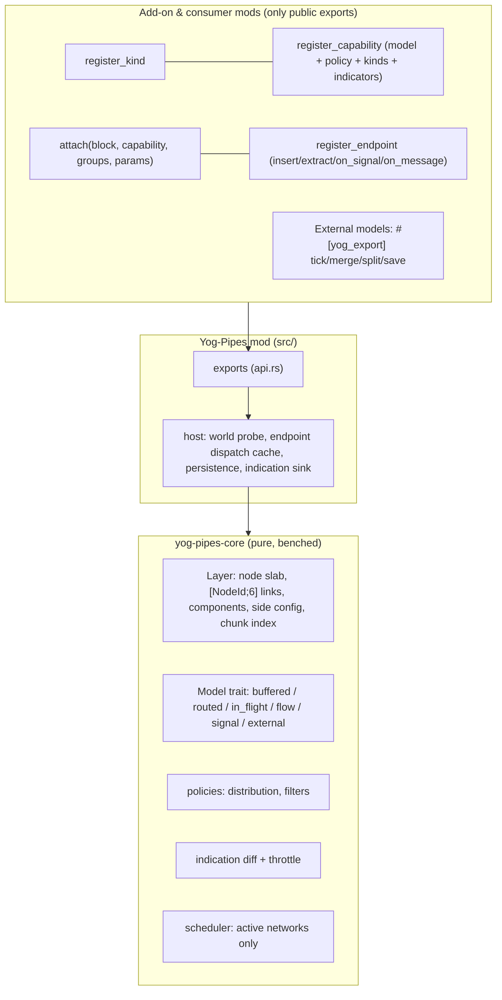

# Design: transport — abstract pipes, composable capabilities, pluggable models

Status: **accepted, being implemented** (2026-10-13). Supersedes the 0.4 API (`PipeDef`/`PipeKind`,
`broadcast`/`send`/`read`/`bind_handler`). Measured against Yog-Pipes 0.4.0 and yog-api 0.92.

The user's complaints about 0.4, in one line each: `send`/`broadcast` create payloads from nothing
(the source is never debited), `broadcast` copies the payload into every node, a handler can't say
"I took 30 of 64", `read` never consumes, a node keeps only its last payload, `PipeDef.properties`
(speed, capacity) are never read, transfer is instant over any distance, and everything is slow
(a `String` cloned per visited neighbour, a full BFS per broadcast and per send). The scope the
user set afterwards:

- *"Rethink the idea of transferring energy, signals and so on. Everything must be possible, like
  pipes from any mod, and fast."*
- *"No strictly typed pipes (energy, fluid, …). Ideally an abstract pipe."* Typed pipes, if anyone
  wants them, are separate add-on mods built on Yog-Pipes ("Yog Pipes Energy/Fluids/Signals"), and
  even those provide abstract *capabilities*, so that one block can carry fluid + energy + signal
  like Mekanism's or Thermal's combined cables.

Ground rules (the user's standing rules): no backward compatibility (0.4 APIs are deleted, not
deprecated) but **no capability is lost** (raw payload messaging and signals stay); Yog-Pipes is
generic (no concrete resources, no items, no energy units); the loader stays generic; mods
hand-write only real logic; no hand-written rendering.

---

## 0. Decisions at a glance

| # | Decision |
|---|---|
| T1 | **One abstract pipe.** A pipe is any block with at least one *capability* attached. There is no pipe kind; `PipeKind` and `PipeDef` are deleted. |
| T2 | **Capabilities compose.** Any number of mods attach capabilities to the same block id without knowing each other. Each capability has its **own layer**: its own link groups, side modes, colors, networks and model state. A combined cable is simply a block in several layers. |
| T3 | **Transport models are a Rust trait** (`yog_pipes_core::Model`). Built-in models implement exactly that trait; a mod-defined model gets the same hooks through the `External` adapter (§5.7). Models are named by *mechanic* (buffered, routed, in-flight, flow, signal), never by resource. |
| T4 | **Resources are typed by an open kind registry.** `register_kind("ns:id", KindDef)` (discrete/continuous, merge rule, conversions, unit label). Capabilities declare the kinds they carry; endpoints declare the kinds they take/give; mismatches are refused at registration, and a mismatching resource offered at run time is refused *and logged*, never silently moved. |
| T5 | **Conservation is enforced by the engine, not trusted to callers.** Every unit that leaves an endpoint is accounted for: in a buffer, in flight, in a segment, in another endpoint, or reported as *spilled/lost* through the capability's event hook. Amounts are `u64` integers so the books balance exactly. |
| T6 | **Incremental components.** Networks have ids; placing a pipe unions neighbouring networks (smaller relabelled into larger), breaking one runs an interleaved multi-source BFS that stops as soon as all but one piece is closed (cost ∝ the smaller pieces). |
| T7 | **Ticks touch only active networks**, and inside a network only active endpoints/units/segments. Idle networks cost nothing. |
| T8 | **Integer ids everywhere on hot paths**: interned dimensions (`DimId(u16)`), `Pos` is 16 bytes `Copy`, nodes are `u32` slab indices with an inline `[NodeId; 6]` adjacency, resources are interned `ResId(u32)`. FxHash for position maps. |
| T9 | **Endpoint handlers are resolved once** per (mod, symbol) and cached as function pointers. A mod calling any `register_*` again (which is what a hot-reloaded mod does in its `register`) invalidates that mod's cache. |
| T10 | **Indication is declarative.** A capability declares indicator properties (`fill`, `flow`, `units`, `power`, …, namespaced by the capability's state prefix); models publish quantised values; the engine diffs, throttles and emits only changes. Applying them as block-state properties needs one generic loader primitive (§9). |
| T11 | **Messaging is a layer feature, not a model.** Every capability layer can carry raw `PipePayload`s point-to-point (`post`) and to all listeners (`broadcast`), with a consuming inbox (`receive`). This replaces 0.4's `send`/`broadcast`/`read` with equal power and O(1)/O(listeners) cost instead of O(network). |
| T12 | **Pure core, thin host.** `core/` (`yog-pipes-core`) has no yog-api dependency: graph, layers, models, policies, persistence encoding, indication diffing. It is unit-, property- and criterion-tested. `src/` is the mod: interop exports, world probe, endpoint dispatch, saving. |

---

## 1. Survey: what real mods do

| Mod / mechanic | Topology | What moves | Notable rules | Yog-Pipes model |
|---|---|---|---|---|
| **Mekanism** universal cable, mechanical/pressurized pipe | network | quantity into a **shared network buffer** (capacity = Σ per-tier cable capacity) then out to acceptors | per-tier throughput; one fluid/gas per network; buffer split per cable on save/break; networks merge when joined | `buffered` |
| **Thermal** fluxducts / fluiducts | network | buffered quantity | duct tiers, per-side in/out/off, filters on attachments | `buffered` + side config + filters |
| **Flux Networks** | wireless network | buffered pool | priorities, per-plug limits | `buffered` (Priority) + external grouping |
| **IC2** cables | network | **EU packets** source→sink each tick | voltage tiers; loss per block by cable material; packet > cable tier burns the cable; > machine tier explodes it | `routed` with `loss_per_block` and `max_packet` + `Overload` event |
| **Immersive Engineering** wires | graph of connectors | packets | wire length limits, loss per length, overload burns wire | `routed` (loss, overload); long wires = links supplied by the mod (expressible via External; see §11) |
| **AE2** | network | **network-wide power pool**; items are stored, not routed | channel counts per cable (8/32), controllers | power: `buffered`; channels: `External` (constraint) |
| **Create** stress | rotation network | not a flow: Σ stress ≤ Σ capacity | overstress stops the whole network | `External` constraint model (§5.7) |
| **Create** fluids | pipes | fluid per segment, **pumps create pressure**, propagates, reach limited by pump | flow direction, open ends spill | `flow` with pump potentials |
| **BuildCraft** item pipes | pipes | **items physically in flight** at pipe speed | extraction by engine/wooden pipe, gates, diamond-pipe filters, items bounce back | `in_flight` + filters + per-side modes |
| **BuildCraft** fluid pipes | pipes | fluid per segment with direction & capacity | flow only to lower pressure, per-segment capacity | `flow` |
| **Mekanism** logistical transporter | pipes | items in flight, **color-sorted**, returning / stuck items | items return to source if dest gone; idle items wait | `in_flight` (color filter, return, stuck retry) |
| **Thermal** itemducts | pipes | in flight, servos/filters | round-robin/nearest | `in_flight` + policy |
| **Pipez / EnderIO** conduits | network | **instant** routing per tick | round-robin / nearest / random, priority, filters, extract/insert/disabled per side, redstone control | `routed` |
| **AE2 / Refined Storage** | network | instant network storage access | no in-flight items | `routed` (instant) + messaging for queries |
| **Vanilla redstone** | wire | signal level | −1 per block, max 15 | `signal` with `attenuation = 1` |
| **Project Red** bundled cables | cable | 16 colored channels | per-channel levels, insulated wires = one color | `signal` with 16 channels + color |
| **EnderIO / AE2** channels, wireless frequencies | network/global | signals, data | channels, frequencies | `signal` channels; wireless = `External` or a mod grouping endpoints |

Cross-cutting requirements every model must honour: per-side connection modes
(`in`/`out`/`both`/`off`), filters, priorities, colors/channels, redstone-style enable,
tiers changing speed/capacity, chunks unloading under a network, multiple dimensions, client
display sync.

---

## 2. Layers of the design



1. **Core topology** (`core/src/layer.rs`): per capability one `Layer` — node slab, position
   index, networks with ids, incremental union/split, side config, colors, chunk index.
2. **Models** (`core/src/model/*.rs`): the `Model` trait and the built-ins.
3. **Policies** (`core/src/policy.rs`): distribution orders and filters, shared by every model
   that chooses destinations.
4. **Indication** (`core/src/indicate.rs`): declared indicator properties, quantisation, diffing,
   throttling.
5. **Engine** (`core/src/engine.rs`): registries (kinds, capabilities, block types, endpoint
   types), the layers, the scheduler, persistence records.
6. **Host** (`src/`): the only code that touches yog-api.

### 2.1 Core vs. add-on mods

Yog-Pipes defines **no** resource, kind, capability or pipe. Everything a "Yog Pipes Energy",
"Yog Pipes Fluids" or "Yog Pipes Signals" add-on would do is done through the public
`yog_pipes_exports` crate:

| An add-on needs to… | Public API |
|---|---|
| define its resource conventions (`ns:fe`, `ns:fluid`, `ns:redstone`) | `register_kind` |
| define an abstract capability others attach to their blocks (`ns:power`) | `register_capability` with any built-in model or `External` |
| ship a model the core doesn't have | `ModelSpec::External` + `#[yog_export]` hooks, with `endpoint_insert`/`endpoint_extract`/`network_view` for I/O (§5.7) |
| let machines plug in | `register_endpoint` (by block id or by position) |
| configure sides, colors, enable/disable | `set_side`, `set_color` |
| drive indication | indicators in `CapabilityDef` (+ `IndicatorSource::External` for external models) |
| react to burns, overloads, spills | `CapabilityDef.on_event` |
| inspect networks (tooltips, probes, debug) | `network_info`, `node_info`, `indication` |

Nothing in that list is private to Yog-Pipes; built-in models use the same entry points through
the `Model` trait.

---

## 3. The abstract pipe and capability composition

```text
block "mymod:universal_cable"
 ├─ capability "yog_pipes_energy:power"   groups ["cable"]   params { capacity: 1000, throughput: 200 }
 ├─ capability "yog_pipes_fluids:fluid"   groups ["pipe"]    params { capacity: 500,  rate: 50 }
 └─ capability "yog_pipes_signals:bundle" groups ["bundle"]  params { attenuation: 1 }
```

- `attach(PipeAttach { block_id, capability, link_groups, params })`. `params` is an open
  `Vec<(String, f64)>` read by the capability's model (`capacity`, `throughput`, `speed`, …);
  unknown keys are refused at attach time (each model publishes its parameter names), so a typo
  can't silently do nothing.
- Each capability has its own **layer**. Two adjacent blocks link in layer *C* iff both carry
  *C*, their *C* link groups intersect, neither side is `off` in *C*, and their *C* colors are
  compatible (`0` = uncolored links to anything, otherwise equal). So one block can be in an
  energy network spanning a whole base and in a signal network of three blocks.
- A capability may declare `exclusive: true` — no other exclusive capability may then be attached
  to the same block (for models that assume they own the block, e.g. two `flow` capabilities
  fighting over one segment volume). Non-exclusive capabilities always compose.
- Indicators are namespaced by the capability's `state_prefix` (validated unique, `[a-z0-9_]`),
  so `power_fill` and `fluid_fill` on one block never collide (§9).

### 3.1 Resource kinds

```rust
register_kind(KindDef {
    id: "yog_pipes_energy:fe".into(),
    form: KindForm::Continuous,          // or Discrete (units are whole things: stacks, packets)
    merge: MergeRule::ById,              // or ByIdAndData (item stacks with NBT)
    unit: "FE".into(),                   // label for tooltips/indication
    conversions: vec![Conversion { to: "other:eu".into(), num: 1, den: 4 }],
})
```

A `Resource` is `{ kind, id, data }` (`id` may equal the kind for single-variant kinds like
energy; `data` is opaque bytes, e.g. SNBT for item components). Capabilities list the kinds they
carry; endpoints list the kinds they accept/provide; `register_endpoint` fails if the two sets
(through conversions) don't meet. Two resources merge into one portion iff the kind's merge rule
says so.

### 3.2 Endpoints

Endpoints are the machines next to the pipes, not the pipes. They are registered **by block id**
(every such block adjacent to a pipe of the capability is an endpoint, discovered with the
network — no per-placement binding code) or **by position** (for blocks the mod doesn't own,
e.g. a vanilla chest at one spot).

```rust
register_endpoint(EndpointDef {
    target: EndpointTarget::Block("mymod:battery".into()),
    capability: "yog_pipes_energy:power".into(),
    mod_id: "mymod".into(),
    kinds: vec!["yog_pipes_energy:fe".into()],
    insert: Some("battery_insert".into()),     // fn(InsertRequest) -> u64
    extract: Some("battery_extract".into()),   // fn(ExtractRequest) -> Stack
    on_signal: None, on_message: None,
    link_groups: vec!["cable".into()],         // which pipes it plugs into (empty = any)
    priority: 0,
    max_packet: 0,                             // 0 = no limit; above → Overload event
})
```

`insert(simulate)` returns what it *accepted*; `extract(simulate)` returns what it *gave*. The
engine debits/credits exactly those numbers (and clamps a handler that claims more than asked,
logging it once — a buggy handler can lose its own units but never create them in the network).

### 3.3 Side configuration

Per (layer, node, face): `SideConfig { mode: In|Out|Both|Off, enabled, priority, filter,
color }`. Faces towards pipes: `Off` cuts the link (wrench). Faces towards endpoints: `In` = the
network only inserts there, `Out` = only extracts, `Both`, `Off` = not connected; `enabled =
false` is redstone control (the mod flips it from its own redstone logic). `filter` is an
allow/deny list of resource ids/kinds/data (§6). Color on a node (`set_color`) partitions
networks (Mekanism transporter colors, Project Red insulated wires).

---

## 4. Core topology

### 4.1 Data layout

```rust
pub struct Pos { pub dim: DimId, pub x: i32, pub y: i32, pub z: i32 }   // 16 B, Copy, FxHash
struct Node { pos: Pos, block: BlockTypeId, links: [NodeId; 6], net: NetId, color: u8,
              sides: [SideConfig; 6] /* small, default = Both */, mark: u32 }
pub struct Layer { nodes: Vec<Node>, free: Vec<u32>, index: FxHashMap<Pos, NodeId>,
                   nets: Slab<Network>, chunks: FxHashMap<ChunkKey, Vec<NodeId>>, ... }
struct Network { id: NetId /* index + generation */, size: u32, type_counts: SmallVec<(BlockTypeId,u32)>,
                 endpoints: Vec<EpConn>, version: u32, active: bool, frozen: u32 /* unloaded nodes */ }
```

- Adjacency is `[NodeId; 6]` by face (no hash sets): BFS touches contiguous memory.
- `mark` is a per-node stamp so BFS needs no `visited` set allocation: bump a global epoch,
  compare stamps.
- `NetId` carries a generation so a cached route/indication keyed by a dead network id can't
  alias a new one.
- Capacity/throughput aggregates come from `type_counts` (few distinct block types per network),
  never from walking nodes.

### 4.2 Place

`on_placed(pos)`: probe the block once; for each layer the block type is in: add the node, look
at the 6 neighbours (known nodes: link if the rule in §3 holds; unknown pipes: discover them, see
4.4), attach endpoints found next to it. Then **union**: 0 neighbouring networks → new network;
1 → join; k > 1 → keep the largest, relabel the others by BFS (union by size, so each node is
relabelled O(log n) times over any sequence of placements). Models get
`merged(into, from)` / `node_added` callbacks; the network's `version` is bumped (route caches
keyed by version die).

### 4.3 Break and split detection

`on_removed(pos)`: models first get `node_removed` (spill that node's share/units), then the node
is unlinked. Let *N* be its distinct linked neighbours (≤ 6). |N| ≤ 1 → no split. Otherwise run
an **interleaved BFS** from every neighbour, one node per search per round, with union-find over
the searches (two searches meeting are the same piece). A piece whose frontier empties is closed:
it is a complete component. Stop as soon as at most one piece is still open — that one keeps the
old `NetId` without being walked to the end. Cost: O(k · Σ closed pieces), i.e. proportional to
the smaller side(s); breaking a pipe in a loop costs only until the two searches meet.
Each closed piece becomes a new network; models get `split(from, parts)` and divide their state
(§5).

### 4.4 Discovery and the probe

World access is the `Probe` trait: `fn block(&self, pos) -> Option<BlockTypeId>` (one host call =
one `get_block` + a hash lookup of the id). Discovery is BFS over unknown positions only, bounded
by `MAX_DISCOVERY` (262 144 nodes, not probed positions) per call. Networks saved with the world are re-discovered eagerly on
the first ticks after start from their saved representative positions (not lazily on first use
as in 0.4 — a network must exist to tick).

### 4.5 Chunk loading

A node in an unloaded chunk makes its network **frozen** (`frozen > 0`): it is not ticked, its
units don't move, nothing is pulled into or pushed out of it, so nothing can dupe through a
half-loaded network and nothing is lost. The core keeps a chunk → nodes index so
`set_chunk_loaded(dim, cx, cz, loaded)` is O(nodes in that chunk). **Host gap:** yog-api 0.92 has
no chunk load/unload events, so today the host never reports unloads (a network spanning
unloaded chunks keeps ticking as in 0.4; `get_block` loads chunks on access). Needed loader
primitive: `on_chunk_load`/`on_chunk_unload` server events (§11).

### 4.6 Scheduler

Each layer has an `active` list of networks. A network is (re)activated by: topology change,
endpoint attached, `wake(pos)` (a machine announces it has something to give or room to take),
signal emission, or its model asking to stay active (`tick` returns `Activity::Active`, or
`Sleep(n)` = wake me in n ticks — used for source polling intervals). Inactive networks cost
nothing per tick.

---

## 5. Models

### 5.1 The trait

```rust
pub trait Model: Send {
    /// Parameter names this model reads from `attach` params (others are refused).
    fn params(&self) -> &'static [&'static str];
    fn net_created(&mut self, net: NetId);
    fn node_added(&mut self, cx: &mut Cx, node: NodeId, net: NetId);
    fn node_removed(&mut self, cx: &mut Cx, node: NodeId, net: NetId);   // spill that node's share
    fn merged(&mut self, cx: &mut Cx, into: NetId, from: NetId);
    fn split(&mut self, cx: &mut Cx, from: NetId, parts: &[(NetId, u32 /* nodes */)]);
    fn net_removed(&mut self, cx: &mut Cx, net: NetId);
    fn tick(&mut self, cx: &mut Cx, net: NetId) -> Activity;
    fn save(&self, cx: &SaveCx, out: &mut Vec<Record>);      // (position, bytes)
    fn restore(&mut self, cx: &mut Cx, node: NodeId, net: NetId, bytes: &[u8]);
    fn totals(&self, net: NetId, out: &mut Vec<(ResId, u64)>);  // for info + conservation tests
}
```

`Cx` gives the model its layer view (nodes, links, side configs, network endpoints, per-network
aggregates, cached BFS trees/distances), endpoint I/O (`insert`, `extract`, `signal`, `message`),
`spill`/`lost`/`event`, indicator publishing and the RNG. Model state lives in the model: per
network in a `NetMap<T>` (dense by net index), per node in a `NodeVec<T>` (dense by node index,
so merges and splits don't move per-node data at all).

### 5.2 `buffered` — shared network buffer

Mekanism/Thermal/Flux energy, Mekanism fluids, AE2 power, any mana/heat pool.

- State per network: `{ res: Option<ResId>, amount: u64 }`; capacity = Σ `capacity` param of its
  pipes. **One resource per network** (Mekanism rule): an empty buffer adopts the first resource
  pulled.
- Tick: pull from `Out`/`Both` endpoints (each ≤ `throughput` per tick, filtered, until the
  buffer is full), then push to `In`/`Both` endpoints by the distribution policy (each ≤
  `throughput`). Sinks see `insert(res, n)` and the buffer is debited by exactly the returned
  amount. Even split simulates first and water-fills.
- Merge: amounts add. If both buffers hold *different* resources, the larger amount is kept and
  the smaller is reported `spilled` at the joining node (documented choice D3).
- Split: amounts divided proportionally to node counts, integer floor, remainder to the largest
  part. Node removed: that node's share `amount / size` (remainder stays) is `spilled`.
- Invariant: `Σ extracted = Δbuffer + Σ inserted + Σ spilled` per tick, exactly.
- Indicators: `fill` = ⌈amount / capacity · levels⌉ per network; `flow` = whether anything moved.
- Saved: one record per network at a representative node: `(res, amount)`.

### 5.3 `routed` — instant routing (with optional loss and packet limits)

Pipez, EnderIO, AE2-style item access, IC2 EU packets, IE wires.

- No storage. Every `interval` ticks each source (round-robin start) is simulated for up to
  `throughput`; destinations are ordered by the policy and filters; sinks are simulated, the
  source is extracted for real (only what was planned), sinks are inserted for real, and anything
  a sink then refuses goes to the next sink, back into the source, or is `spilled` — never lost.
- `loss_per_block` (fixed-point ‰ per block, distance = BFS hops cached per network version):
  the sink receives `n − loss`, `loss` is reported `lost` (IC2/IE). Invariant:
  `Σ extracted = Σ inserted + Σ lost + Σ spilled`.
- `max_packet` on pipes (network minimum) and on endpoints: a transfer above it raises
  `Overload { at, amount, limit }` on the capability's event hook; the mod decides (burn the cable
  with `break_block`, explode the machine). The transfer still happens (IC2 semantics: the
  packet arrives, then things burn); a mod that wants it blocked returns 0 from `insert`.

### 5.4 `in_flight` — discrete units travelling

BuildCraft, Mekanism logistical transporters, Thermal itemducts — for any discrete kind.

- Every `interval` ticks per source: simulate extract up to `stack`; pick a destination by policy
  among endpoints that simulate-accept; extract for real; spawn a unit
  `{ res, amount, node, progress, dest, source }`. Per-tick cost is O(units in flight).
- Movement: `progress += speed(node)` (blocks/tick, 16.16 fixed point); crossing 1.0 moves to the
  next hop. Next hop comes from a **BFS tree rooted at the destination's pipe node**, cached per
  (network version, destination): units store no path, so a topology change needs no per-unit
  work — a unit simply follows the new tree.
- Arrival: `insert(amount)`; the remainder re-targets (another accepting sink), else returns to
  its source, else waits (`stuck`, retried every `retry` ticks — Mekanism's idle items). Never
  duplicated; never dropped while its pipe exists.
- Network change under a unit: if its destination is no longer in its network it re-targets /
  returns; when the pipe it is in is broken it is `spilled` (the capability's event hook decides:
  drop an item entity, void, …).
- Color: a unit inherits the source side's color; filters can match on it (sorting).
- Indicator: `units` per node = number of units in that node (clamped to the indicator's levels).
- Saved: one record per unit at its node.

### 5.5 `flow` — per-segment volumes with pressure

BuildCraft fluid pipes, Create fluids, Thermal fluiducts in "per-segment" style.

- State per node: `{ res, amount }`, capacity per pipe (`capacity` param). Each tick, for the
  **active set** of nodes only, move `min(rate, ⌊(hᵢ − hⱼ)/2⌋)` to each linked neighbour with lower
  head and a compatible resource, where `h = amount + pressure · potential`. Potentials come from
  pumps: endpoints with `pressure > 0` set potential `range − distance` (multi-source BFS cached per
  network version), so flow runs away from pumps for `range` blocks like Create; with no pumps it
  is plain equalisation (BuildCraft). Sources inject into their adjacent node, sinks drain theirs.
- Resource per segment: a segment holding resource A never takes B (BuildCraft). Networks can
  hold several resources in different segments.
- A node settles (leaves the active set) when no transfer happened from or to it; any change next
  to it re-activates it. Per-tick cost ∝ nodes actually flowing.
- Merge/split: nothing to move (per-node state). Node removed: its content is `spilled`.
- Invariant: transfers are pairwise integer moves; `Σ segments + Σ endpoints + spilled` constant.
- Indicator: `fill` per node.

### 5.6 `signal` — levels on channels, with attenuation

Vanilla redstone, Project Red bundled cables, EnderIO/AE2 channels.

- `channels` (1..=64) per capability; emitters set levels with `emit(pos, channel, level)`
  (event-driven, no polling). With `attenuation = 0` a channel's network level is the max of its
  emitters (O(emitters) per change, maintained per network). With `attenuation > 0` per-node levels
  come from a bounded multi-source BFS (radius `level / attenuation`), recomputed only for the
  channel that changed.
- Listeners (`on_signal` endpoints) are notified only when the level at their node changes.
- Signals are levels, not resources: nothing to conserve (that is the point of the mode).
- Indicator: `power` = max level over channels at a node (per node with attenuation, per network
  without).

### 5.7 `External` — models written in other mods

`ModelSpec::External { mod_id, prefix }`: Yog-Pipes resolves `#[yog_export]` functions
`<prefix>_tick`, `<prefix>_merge`, `<prefix>_split`, `<prefix>_node_removed` (all optional except
`tick`) and keeps the model's per-network state as opaque bytes for it:

```rust
#[yog_export] fn stress_tick(t: ExternalTick) -> ExternalTickResult  // state bytes in/out, activity, indicators
```

`ExternalTick` carries the network handle, node count, aggregates, endpoint list and the state;
inside the tick the model calls Yog-Pipes' `endpoint_insert` / `endpoint_extract` /
`endpoint_signal` exports (these take only the endpoint-dispatch lock, so calling them from inside
a tick is safe) and `network_nodes` for topology. Per-tick cost is one interop call per *active*
network plus the endpoint calls, the same as the built-ins plus one hop. This is how a Create-like
stress network (Σ stress ≤ Σ capacity; overstress → event) or AE2 channel counting is expressed.
Conservation in an external model is that model's responsibility; the endpoint exports still
clamp to the requested amounts.

---

## 6. Policies

`Distribution`: `RoundRobin` (rotating start, the default), `Priority` (endpoint/side priority
descending, round-robin within a priority), `Nearest` (BFS hops from the source, cached per
version), `EvenSplit` (simulate, then water-fill), `Random` (seeded xorshift, deterministic per
world tick for tests). Composable as "order + tie-break": `Priority` always tie-breaks by the
chosen secondary order.

`Filter`: `{ mode: Allow|Deny, entries: [ById(res id) | ByKind(kind) | ByData(bytes) |
ByColor(u8)] }` stored once and referenced by `FilterId`; set on a side. A filter is evaluated
on interned ids (integer compares).

Models that choose destinations (`buffered`, `routed`, `in_flight`, `flow` sources/sinks) all use
the same `policy::order(...)` routine, so a new policy works everywhere.

---

## 7. Messaging (signal mode for raw payloads)

Every layer has: `post(from, to, payload) -> bool` (delivered iff both are in the same network —
an O(1) `NetId` compare — to `to`'s `on_message` handler or its inbox), `broadcast(from, payload)
-> u32` (every `on_message` endpoint of the network, O(listeners)), `receive(pos) -> Option`
(consuming, bounded inbox of 64; `post` returns `false` when full, nothing is silently
overwritten), `latest(pos)` (the network's last broadcast — the 0.4 `read` "level" semantics).

---

## 8. Persistence

The engine saves `Vec<Record { layer, pos, bytes }>` from every model plus side configs, colors,
filters, positional endpoints and inboxes, in a versioned explicit binary format (as 0.4). On load
records are parked by position; when the node at that position is (re)discovered the model's
`restore` gets the bytes. Representative-position records (buffers) whose pipe vanished while the
server was down stay parked and are reported once — never invented, never duplicated.

---

## 9. Indication

A capability declares indicators: `Indicator { name: "fill", levels: 15, source: Fill|Flow|Units|Power|External(idx) }`. The block-state property is `<state_prefix>_<name>` (an int property `0..=levels`),
so composed capabilities never clash. Models publish raw values; the engine quantises, compares
with the last emitted value per node, and flushes changes at most every `indication_interval`
ticks (default 4). Per-network indicators (buffer fill) change all nodes of a network at once, so
they are quantised (≤ 16 levels) and throttled: a 10k-node network costs at most one sweep per
level change, never per tick.

**Loader primitive needed (not in yog-api 0.92):** `.yblock` `states.props`
(`{ "fill": { "values": 16, "models": {...} | "texture_layers": ... } }`, generic int/bool/enum
properties with per-value model parts), the Java block class carrying them on all six hosts, and
`Server::set_block_props(dim, pos, &[(name, value)])` that changes properties without replacing
the block. Until it exists the host keeps the latest values queryable (`indication(pos)`) for
tooltips/HUD readouts; nothing is drawn by Yog-Pipes or by mods. Items visible in transit need a
second generic primitive: a declarative block-entity display list (item stacks at positions inside
a block, driven by data) — `units` indication covers "something is passing" until then.

---

## 10. Performance targets and how they are met

| Scenario | Target | Mechanism |
|---|---|---|
| discover 64k grid | < 30 ms (0.4: 124 ms) | slab + `[NodeId;6]`, interned dims, FxHash, no String clones |
| place/break in a 64k line (split at the middle) | split cost ∝ smaller half; non-splitting break/place < 2 µs | interleaved BFS (§4.3), union by size |
| `buffered`, 10k-node grid, 500 endpoints, tick | < 50 µs (+ endpoint call cost) | per-network aggregates, endpoint list, no graph walk |
| `in_flight`, 10k units in flight | < 500 µs per tick | O(units), next hop from cached destination trees |
| `flow`, 10k segments, settled | ≈ 0 per tick | active set |
| signal change on a 10k network, no attenuation | O(emitters + listeners) | per-network channel maxima |
| `post` between two endpoints | O(1) | `NetId` compare |
| endpoint handler call | one cached fn pointer, one rkyv encode into a reused buffer | dispatch cache (T9) |

---

## 11. Coverage

**Built in:** shared network buffers with tiers and policies (Mekanism, Thermal, Flux, AE2 power);
instant routing with priorities/filters/side modes/redstone enable (Pipez, EnderIO, RS/AE2 access);
packets with distance loss and packet limits with burn/explode events (IC2, IE); items/units in
flight with speed, sorting, return and stuck handling (BuildCraft, Mekanism, Thermal); per-segment
fluids with pumps/pressure (BuildCraft, Create fluids); levels on channels with attenuation and
colors (redstone, Project Red, EnderIO); raw payload messaging; combined pipes.

**Expressible via `External`, not built in:** Create stress (constraint network), AE2 channel
counting, IE long wires (links between distant connectors — a model can treat its connectors as
endpoints and do its own routing), wireless frequencies (a mod groups endpoints by frequency).

**Needs loader primitives** (generic, none exist in yog-api 0.92): block-state properties for
indication (§9), block-entity item display for visible items in transit, chunk load/unload events
(§4.5), a container-inventory API for vanilla chests (`get_inventory_slot` is a stub on every host,
so the item example uses its own storage blocks).

---

## 12. Design choices (open to the user)

| # | Choice | Why / alternative |
|---|---|---|
| D1 | Units are `u64` integers; continuous kinds pick their own base unit (mB, FE). | Exact conservation; floats drift. |
| D2 | `throughput` is per endpoint connection per tick (EnderIO/Pipez); network bottleneck = the lowest tier in the network (Mekanism). | Alternative: a per-network rate shared by all endpoints. |
| D3 | `buffered` networks hold one resource; merging two networks with different resources keeps the larger, spills the smaller. | Mekanism refuses to connect; refusing would make the graph disagree with the arms the player sees. |
| D4 | Removing a pipe spills its share (buffer: `amount/size`; flow: its segment; in-flight: units in it) through the capability event hook; the mod decides (drop items, void energy). | Alternative: keep everything in the remaining network (can exceed capacity). |
| D5 | `flow` allows several resources per network, one per segment. | Create/BuildCraft semantics; `buffered` is the one-resource-per-network model. |
| D6 | Packet overload (`max_packet`) reports and still delivers. | IC2 semantics; a mod can refuse in `insert` to block instead. |
| D7 | Frozen networks (a node in an unloaded chunk) don't tick at all. | Simplest no-dupe rule; per-part ticking would need chunk-local sub-networks. |
